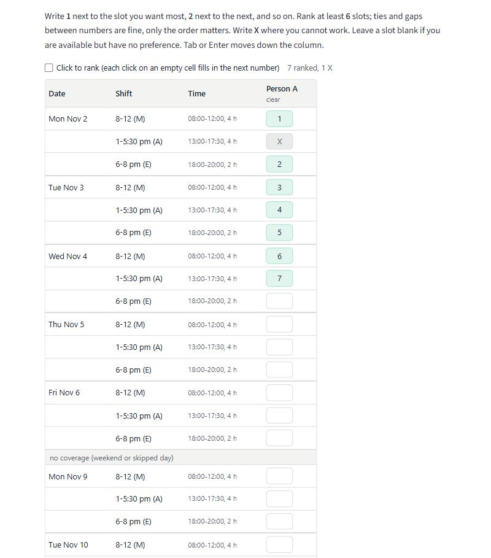

# Participant guide

You get a personal link from the organiser. It opens your own column of the preference
sheet for one on-call period: nobody else sees it, and you do not see anyone else's. The
page works on a phone.

## The sheet

The sheet lists every slot of the period in order: the date (shown on the first row of
each day, with a thicker line at the end of each day), the shift, its time and length, and
one cell for you. A grey "no coverage" row marks a weekend or a skipped day. For each slot
write one of:

- A **number**: your rank. **1** is the slot you want most, **2** the next, and so on. Rank at
  least the number of slots the page asks for (usually six); you may rank more. Ties (two
  slots with the same number) and gaps (1, 2, 5) are fine; only the order matters.
- **X**: you are unavailable. You will never be scheduled in that slot. Use it only when you
  really cannot work then: too many X's can make the schedule impossible for everyone.
- **Nothing**: you are available and have no preference.

A ranked cell turns green and an X turns grey. The sheet tidies what you type: only digits
stay in a rank, and any string of x's becomes a capital X. Next to the "Click to rank" box
the sheet counts how many slots you have ranked and how many more it needs.

Things that make filling the column quicker:

- **Tab**, **Enter** and the **arrow keys** move down (or up) the column, so you can type a
  number, press Enter, type the next, and so on.
- **Click to rank**: tick the box, then each click on an empty cell fills in the next
  number (1, 2, 3, ...). Clicking a cell that already has a value just lets you edit it.
- **clear** (under your name) empties the whole column. Nothing is saved until you click
  Save, so if you clear by mistake, reload the page and your last saved entries come back.

Click **Save my preferences** under the sheet. If something is missing (fewer ranks than
required, or a value such as 0 that is not a rank) the page tells you what to fix and
nothing is saved until you save again. The Save button is greyed out for a moment while the
sheet loads; if it stays greyed out, use the plain form (below).

After saving, the page shows what each rank is worth: your 100 points are spread over the
slots you ranked, with the top rank worth the most. That is what the market uses, so ranking
more slots spreads your points more thinly but tells the market more about you.

On a phone the sheet fits a 390-pixel-wide screen; if a period has long shift names the
sheet scrolls sideways inside the page and your cells stay in view at the right.

## The plain form

If the sheet does not load (an old browser, or scripts blocked), add `&plain=1` to the end
of your link, or follow the "plain form" link under the sheet. The plain form is the same
column as a list of text boxes, one per slot, with the same Save button and the same rules.

## Changing your mind

Open the same link again and change any entry until the organiser closes collection; each
save replaces your earlier one. After the deadline the link shows your saved entries in
the same sheet, read-only, with the colours but no boxes to type in.

If you have not saved anything by the deadline you are left out of this period.

## After the schedule is published

Your link shows the final schedule with your shifts listed, and any changes the organiser
made by hand after the market ran. The organiser also has a public link to the same schedule.

## If the page is asleep

The app runs on a free host and goes to sleep when nobody has used it for a while. If you see
a page saying the app is asleep, click the button to wake it and wait about a minute.

## If your link does not work

Ask the organiser for a new one. Links are personal: do not forward yours.
